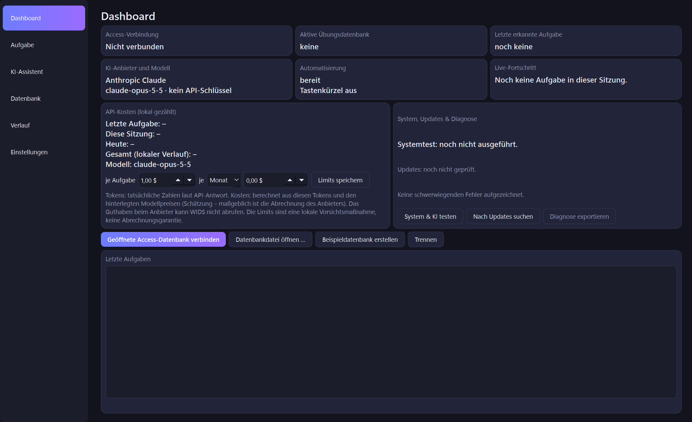

# WIDS ACCESS AI

**Version 1.0.0 Beta 3** · Windows · Microsoft Access · Anthropic Claude · kostenlos, Open Source ([MIT](LICENSE))

> KI-Assistent für Microsoft-Access-**Übungen**: Aufgabe erkennen → Lösung planen → Sicherung → in Access ausführen →
> jede Anforderung unabhängig prüfen → Diagnosebericht. Funktioniert mit jeder Access-Datei, egal wie sie heißt.



| Aufgabe | Einstellungen |
|---|---|
|  |  |

> WIDS ACCESS AI ist ein unabhängiges Projekt und nicht mit Microsoft, Anthropic oder dem Hersteller von te.comp
> verbunden. Es enthält keine Inhalte dieser Hersteller. **Nur für Übungen – nicht für benotete Prüfungen.**

## Funktionen

- **Tabellen:** Felder, Datentypen, Gültigkeitsregeln, Schlüssel, Indizes, Beziehungen, Nachschlagefelder, Anlagen,
  Import und Export (Excel, Text, andere Access-Datenbanken)
- **Abfragen:** Kriterien, Sortierung, berechnete Felder, Gruppierung, Parameter, Unterabfragen, Joins;
  Aktionsabfragen nur nach Bestätigung
- **Formulare:** Layouts, Register, Unterformulare, bedingte Formatierung, Datenquelle und Steuerelementinhalt
- **Berichte:** Gruppen, Summen, Etiketten, mehrspaltiger Druck, Seite einrichten, Kopf- und Fußbereiche,
  automatische Bereinigung überlappender Felder
- **Unabhängige Prüfung:** Jede Anforderung wird nach der Ausführung direkt in Access kontrolliert; Abweichungen gehen
  in eine begrenzte Selbstkorrektur (höchstens 3 Runden, bei Stillstand ein anderer Lösungsweg)
- **Hintergrundbetrieb:** Übung öffnen, **Alt+W** drücken – ohne Fenster, ohne Pop-ups, ohne Fokuswechsel.
  Ein 2 × 2-Pixel-Punkt oben links zeigt den Zustand (gelb = arbeitet, grün = bestätigt, rot = Fehler/angehalten)
- **Keine Freigaben mehr nötig:** Alt+W ist die bewusste Aktion des Benutzers – kein Freigeben von
  Lernprogrammen, Workshops oder Dateien, keine Ablaufzeiten. Prüfungsschutz, Sicherung vor jeder Änderung und
  die Bestätigung löschender Schritte bleiben
- **System & KI testen** (Dashboard): kostenloser Teil auf einer temporären Testdatenbank (Access, COM/DAO,
  Erkennung, sicherer Testplan, unabhängige Prüfung, Sicherung); der KI-Teil (höchstens 0,01 $) startet erst nach
  Bestätigung. Ergebnis: Bestanden, Teilweise oder Fehlgeschlagen mit konkreter Ursache
- **Live-Fortschritt** im Dashboard aus den echten Arbeitsschritten: erkannt → verbunden → KI analysiert → Plan →
  Schritt k von n → Ergebnisprüfung, mit Laufzeit, bestätigten Teilergebnissen und Selbstkorrektur-Status
- **Selbstkorrektur mit Ursache:** Aufgabenerkennung, KI-Plan, Access-Ausführung oder Ergebnisprüfung – gezielt nur
  das Nötige nachbessern, bestätigte Schritte bleiben, höchstens 3 begründete Zyklen
- **Automatische Updates** aus diesem Repository: Hinweis im Dashboard, Download erst nach Zustimmung, SHA-256-Prüfung,
  Selbsttest, Austausch beim Neustart, Rückfall auf die bisherige Version bei Problemen
- **Diagnose** nur bei schwerwiegenden Fehlern, anonymisiert, „Diagnose exportieren“ im Dashboard
- **Unabhängig vom Dateinamen:** „Datenbank1.accdb“, „CD-Sammlung“ oder nummerierte Übungsdateien, auch auf
  Netzlaufwerken

## Download und Start

1. Unter [Releases](https://github.com/samito-ai/WIDS-ACCESS-AI/releases) die Datei `WIDS-Access-AI.exe`
   herunterladen (keine Installation nötig).
2. Optional die SHA-256-Prüfsumme aus den Release-Notes vergleichen:
   `Get-FileHash .\WIDS-Access-AI.exe -Algorithm SHA256`
3. Starten. Die EXE ist **nicht signiert** – Windows SmartScreen kann warnen („Weitere Informationen“ →
   „Trotzdem ausführen“).

**Updates:** Ab Beta 3 meldet das Dashboard neue Versionen und installiert sie nach Zustimmung selbst. Wer noch
Beta 1 oder Beta 2 nutzt, lädt Beta 3 **einmal von Hand** herunter (alte Instanz über das Infobereich-Symbol beenden,
EXE ersetzen) – Einstellungen, Schlüssel und Verlauf bleiben erhalten.

Voraussetzungen: Windows 10/11, Microsoft Access (Desktop), ein eigener Anthropic-API-Schlüssel.

## Schnellstart

1. **Einstellungen** öffnen, den Anthropic-Schlüssel einfügen und **Verbindung testen** klicken.
   Anleitung: [API-Schlüssel sicher einrichten](docs/INSTALLATION.md#anthropic-api-schlüssel-sicher-einrichten).
   Optional im Dashboard **System & KI testen** klicken.
2. Die Übung in Access öffnen und **Alt+W** drücken – keine weitere Freigabe nötig.
3. Ergebnis und Diagnosebericht im Dashboard ansehen.

Kurzanleitung für Kolleginnen und Kollegen: [SCHNELLSTART.md](docs/SCHNELLSTART.md).

Ausführlich: [Installation und Einrichtung](docs/INSTALLATION.md).

## Kosten

WIDS selbst ist kostenlos. Die KI-Anfragen laufen über **deinen eigenen** Anthropic-Schlüssel und werden von
Anthropic nach Verbrauch abgerechnet. Das Dashboard zeigt die Kosten der letzten Aufgabe, der Sitzung, von heute und
gesamt (lokaler Verlauf), das Modell und die Tokens. Die Tokens stammen aus den API-Antworten, die Kosten sind daraus mit
den Listenpreisen berechnet (Schätzung – maßgeblich ist die Abrechnung des Anbieters); das Guthaben beim Anbieter kann
WIDS nicht abrufen. Ein **Budget je Aufgabe** (Standard 1 $) und ein Limit je Tag/Monat/gesamt werden vor jeder
Anfrage geprüft – eine lokale Vorsichtsmaßnahme, keine Abrechnungsgarantie.

## Sicherheit und Datenschutz

- Der API-Schlüssel liegt nur in der Windows-Anmeldeinformationsverwaltung – nie in Dateien, Logs oder im Verlauf.
- Die KI liefert ausschließlich Daten in einem festen Aktionsschema; es wird **kein von der KI erzeugter
  Programmcode** ausgeführt.
- Vor jeder Änderung wird eine Sicherungskopie angelegt. Löschende oder massenhaft ändernde Schritte brauchen eine
  eigene Bestätigung; im Hintergrund wird in solchen Fällen angehalten, nie automatisch bejaht.
- An die KI gehen Aufgabentext und Datenbankstruktur, keine Datensätze (Ausnahme: die ersten Zeilen einer in der
  Aufgabe genannten Quelldatei).
- **Prüfungsschutz:** Läuft eine Prüfungsumgebung (Next Exam, Safe Exam Browser, andere Sperrbrowser oder ein
  Prüfungsmodus), wird die Automatisierung gesperrt. WIDS klickt nie „Prüfen“, „Abschließen“ oder „Upload“.
  Die Verantwortung für den erlaubten Einsatz bleibt bei dir.

Lokale Daten (Einstellungen, Verlauf, Logs, Sicherungen) liegen unter `%LOCALAPPDATA%\WIDS-Access-AI`.

## Entwicklung

```powershell
scripts\setup_dev.ps1   # virtuelle Umgebung anlegen
scripts\run.ps1         # Programm starten
scripts\test.ps1        # Tests ohne KI-Kosten (einige brauchen Microsoft Access)
python build.py         # EXE bauen und Selbsttest
```

Aufbau: `app/access` (Access über DAO/COM), `app/ai` (Anbieter, Kosten, Prompts), `app/tasks` (Aktionsschema),
`app/agent` (Analyse, Ausführung, Prüfung, Selbstkorrektur), `app/vision` (Fenster, OCR), `app/security`,
`app/storage`, `app/ui`. Beiträge: [CONTRIBUTING.md](CONTRIBUTING.md) · Änderungen: [CHANGELOG.md](CHANGELOG.md).

## Unterstützen

WIDS ACCESS AI ist und bleibt kostenlos. Wenn dir das Projekt hilft, freut es sich über einen Stern ⭐,
Fehlermeldungen und Verbesserungsvorschläge unter [Issues](https://github.com/samito-ai/WIDS-ACCESS-AI/issues).
Eine Spendenmöglichkeit gibt es derzeit nicht; falls eine eingerichtet wird, erscheint sie hier und als
„Sponsor“-Schaltfläche im Repository.

## Lizenz

[MIT](LICENSE) – frei nutzbar, veränderbar und weitergebbar, ohne Gewährleistung.
