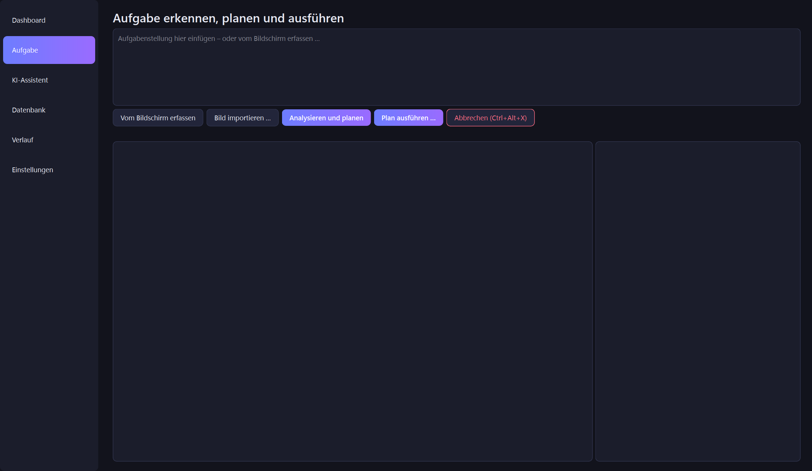
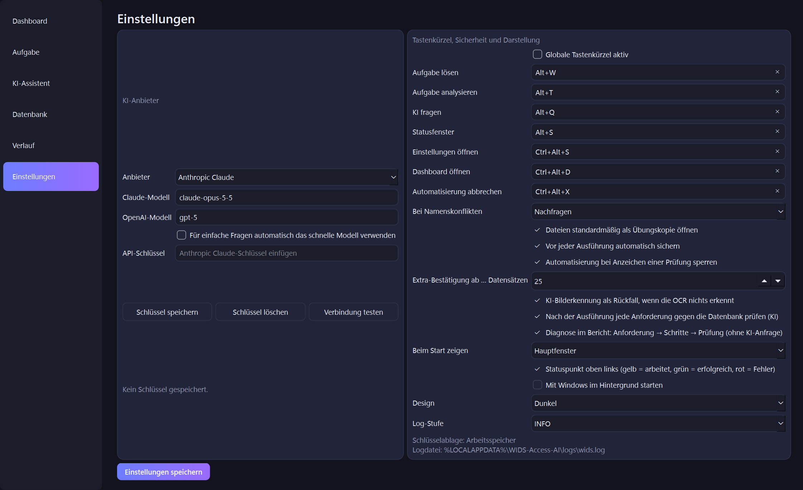

# WIDS ACCESS AI

**Version 1.1.0** · Windows 10/11 · Microsoft Access · Anthropic Claude · kostenlos, Open Source ([MIT](LICENSE))

> KI-Assistent für Microsoft-Access-**Übungen**. Übung öffnen, **Alt+W** drücken: WIDS liest die Aufgabe, plant die
> Lösung, legt eine Sicherung an, führt die Schritte in Access aus und prüft danach jede Anforderung unabhängig.
> Was WIDS nicht nachweisen kann, meldet es ehrlich als „nicht abgeschlossen“, nie als Erfolg.


| Aufgabe | Einstellungen |
|---|---|
|  |  |

> WIDS ACCESS AI ist ein unabhängiges Projekt und nicht mit Microsoft, Anthropic oder dem Hersteller von te.comp
> verbunden. **Nur für Übungen, nicht für benotete Prüfungen.**

## So funktioniert es

1. **Erfassen:** Aufgabentext der geöffneten Übung (te.comp-Lernprogramm, Workshop oder eigene Datei, der Name ist
   egal), Abbildungen der Aufgabenseite und der Aufbau der Datenbank.
2. **Planen:** Die KI liefert nur Daten in einem festen Aktionsschema. WIDS prüft den Plan gegen die echte Datenbank.
   Es wird **nie von der KI erzeugter Programmcode** ausgeführt.
3. **Sichern:** Vor jeder Änderung eine Sicherungskopie. WIDS prüft, dass die Datei wirklich angelegt wurde.
4. **Ausführen:** Schritt für Schritt in Access. Sperren werden erkannt und wiederholt, fremde Sperren nie
   aufgebrochen.
5. **Prüfen:** Jede Anforderung wird über eine eigene Verbindung direkt in der Datenbank kontrolliert. Abweichungen
   gehen in höchstens 3 begründete Selbstkorrektur-Runden.
6. **Melden:** Der Statuspunkt oben links zeigt gelb (arbeitet), grün (alles nachgewiesen) oder rot (nicht
   abgeschlossen). Im Verlauf stehen Bericht, Grund und Sicherung.

## Unterstützte Aufgaben

| Bereich | Unterstützt (mit echtem Access getestet) |
|---|---|
| Tabellen | anlegen und ändern, Felder, Datentypen, Feldeigenschaften, Gültigkeitsregeln, Primärschlüssel, Indizes, Nachschlagefelder, Datenblatt-Layout |
| Beziehungen | anlegen mit referentieller Integrität, Aktualisierungs- und Löschweitergabe |
| Abfragen | Auswahl mit Kriterien, Sortierung, berechneten Feldern, Gruppierung, Parametern, Joins; Aktionsabfragen; vorhandene Abfragen erweitern |
| Formulare | anlegen und ändern, Layouts, Register, Unterformulare, bedingte Formatierung, Formularfilter |
| Berichte | anlegen und ändern, Spalten- und Tabellenlayout (nachgemessen), Gruppen, Summen, Etiketten, Filter und Sortierung, abwechselnde Zeilenfarbe |
| Daten | Datensätze einfügen, ändern und löschen, Import und Export (Excel, Text, Access) |
| Fragen | Datenfragen per nur lesender Abfrage beantwortet und nachgeprüft, Rechenfragen exakt berechnet, Multiple Choice mit Begründung je Option |
| Mehrteilige Aufgaben | unabhängige Teile laufen weiter, auch wenn ein einzelner Schritt blockiert ist |
| te.comp-Workshops | **ein Alt+W für den ganzen Workshop:** WIDS liest alle Teilaufgaben aus der te.comp-Aufgabenleiste, plant sie gemeinsam in sinnvoller Reihenfolge, prüft jede einzeln und meldet „vollständig“ nur, wenn alle nachgewiesen sind |

**Ohne Rückfragen, mit technischem Schutz:** Alt+W ist die Zustimmung. Eindeutige Schritte laufen automatisch nach
der Sicherung, auch Löschungen mit klarer Bedingung (höchstens 25 Datensätze je Schritt, einstellbar) und das Löschen
benannter Objekte. Nicht eindeutige Schritte werden nicht geraten, sondern nur als Schritt **blockiert**: „alle
Datensätze“, mehr Treffer als die Grenze, Löschweitergabe, verknüpfte Tabellen und verlustbehaftete Typänderungen.

## Bekannte Grenzen

- Formatierungen „gemäß Abbildung“ gelten nur dann als erfüllt, wenn die Abbildung genug Werte liefert. Sonst meldet
  WIDS „nicht abgeschlossen“ und nennt den Grund.
- PDF-Unterlagen werden nicht gelesen (Excel, Text, CSV und Word schon).
- Antworten auf Fragen zeigt WIDS an. Es trägt sie nicht in te.comp ein und klickt nie „Prüfen“ oder „Abschließen“.
- Makros und VBA-Code erstellt WIDS nicht.
- Wer die automatische Sicherung in den Einstellungen abschaltet, verliert die Rückkehrmöglichkeit: Löschungen laufen
  dann nicht mehr automatisch, Änderungen mit Bedingung schon.
- Die EXE ist nicht signiert. Windows SmartScreen kann beim ersten Start warnen.
- Die Kosten berechnet WIDS aus Tokens und Listenpreisen. Maßgeblich ist die Abrechnung von Anthropic.
- Workshops: Zum Lesen aller Teilaufgaben blättert WIDS kurz mit te.comps eigenen Pfeilen durch die Aufgabenleiste
  (ohne Mausbewegung und Fokuswechsel, danach steht sie wieder wie vorher). Ein großer Workshop kostet mehr als eine
  Einzelübung; reicht das Aufgabenbudget nicht, bricht WIDS mit Grund ab. Nicht jede Teilaufgabe wird automatisch
  gelöst (im Test „CD-Sammlung“ 9 von 12); offene Teilaufgaben meldet WIDS mit Nummer, nie als erledigt.

## Download und Start

1. Unter [Releases](https://github.com/samito-ai/WIDS-ACCESS-AI/releases/latest) die Datei `WIDS-Access-AI.exe`
   herunterladen. Eine Installation ist nicht nötig.
2. Optional die SHA-256-Prüfsumme aus den Release-Notes vergleichen:
   `Get-FileHash .\WIDS-Access-AI.exe -Algorithm SHA256`
3. Starten. Warnt SmartScreen: „Weitere Informationen“, dann „Trotzdem ausführen“.

**Voraussetzungen:** Windows 10 oder 11 (64 Bit), Microsoft Access 2016 oder neuer (Desktop, einmal von Hand
gestartet) und ein eigener Anthropic-API-Schlüssel.

**Updates:** Das Dashboard meldet neue Versionen. „Update installieren“ lädt die EXE erst nach Zustimmung, prüft die
SHA-256-Prüfsumme, testet die neue Version und legt bei Problemen automatisch die bisherige zurück. Einstellungen,
Schlüssel und Verlauf bleiben erhalten. Die Stable-Version bekommt nur Stable-Updates angeboten.

## Schnellstart

1. **Einstellungen** öffnen, den Anthropic-Schlüssel einfügen und **Verbindung testen** klicken.
   Anleitung: [API-Schlüssel sicher einrichten](docs/INSTALLATION.md#anthropic-api-schlüssel-sicher-einrichten).
2. Optional im Dashboard **System & KI testen**: zuerst kostenlos auf einer Testdatenbank, dann nach Zustimmung ein
   KI-Test für höchstens 0,01 $.
3. Die Übung in Access öffnen und **Alt+W** drücken.
4. Ergebnis und Bericht im Dashboard unter **Verlauf** ansehen.

Weitere Anleitungen: [Schnellstart](docs/SCHNELLSTART.md) · [Installation](docs/INSTALLATION.md) ·
[Vorführung mit eigenen Testdaten](docs/DEMO.md)

## Kosten

WIDS selbst ist kostenlos. Die KI-Anfragen laufen über **deinen eigenen** Anthropic-Schlüssel, eine typische Übung
kostet etwa 0,05–0,35 $. Das Dashboard zeigt die Kosten der letzten Aufgabe, der Sitzung, von heute und gesamt. Ein
**Budget je Aufgabe** (Standard 1 $) und ein Limit je Tag, Monat oder gesamt werden vor jeder Anfrage geprüft. Das
Ausgabenlimit in der Anthropic-Konsole bleibt der verlässliche Schutz.

## Sicherheit und Datenschutz

- Der API-Schlüssel liegt nur in der Windows-Anmeldeinformationsverwaltung, nie in Dateien, Logs oder im Verlauf.
- Vor jeder Änderung eine geprüfte Sicherung; Wiederherstellung im Verlauf mit einem Klick.
- An die KI gehen Aufgabentext, Abbildungen der Aufgabenseite und die Datenbankstruktur, keine Datensätze. Ausnahme:
  die ersten Zeilen einer in der Aufgabe genannten Quelldatei.
- **Prüfungsschutz:** Läuft eine Prüfungsumgebung (Next Exam, Safe Exam Browser, andere Sperrbrowser oder ein
  Prüfungsmodus), sperrt sich die Automatisierung. Die Verantwortung für den erlaubten Einsatz bleibt bei dir.

Lokale Daten (Einstellungen, Verlauf, Logs, Sicherungen) liegen unter `%LOCALAPPDATA%\WIDS-Access-AI`.

## Versionen

WIDS folgt [Semantic Versioning](https://semver.org/lang/de/): `1.0.x` für Fehlerbehebungen, `1.x.0` für neue
rückwärtskompatible Funktionen, `2.0.0` für grundlegende Änderungen. Änderungen: [CHANGELOG.md](CHANGELOG.md).

## Entwicklung

```powershell
scripts\setup_dev.ps1   # virtuelle Umgebung anlegen
scripts\run.ps1         # Programm starten
scripts\test.ps1        # Tests ohne KI-Kosten (einige brauchen Microsoft Access)
python build.py         # EXE bauen und Selbsttest
```

Aufbau: `app/access` (Access über DAO/COM), `app/ai` (Anbieter, Kosten, Prompts), `app/tasks` (Aktionsschema),
`app/agent` (Analyse, Ausführung, Prüfung, Selbstkorrektur), `app/vision` (Fenster, OCR), `app/security`,
`app/storage`, `app/ui`. Beiträge: [CONTRIBUTING.md](CONTRIBUTING.md).

## Unterstützen

WIDS ACCESS AI ist und bleibt kostenlos. Wenn dir das Projekt hilft, freut es sich über einen Stern ⭐, Fehlermeldungen
und Verbesserungsvorschläge unter [Issues](https://github.com/samito-ai/WIDS-ACCESS-AI/issues).

## Lizenz

[MIT](LICENSE): frei nutzbar, veränderbar und weitergebbar, ohne Gewährleistung.
